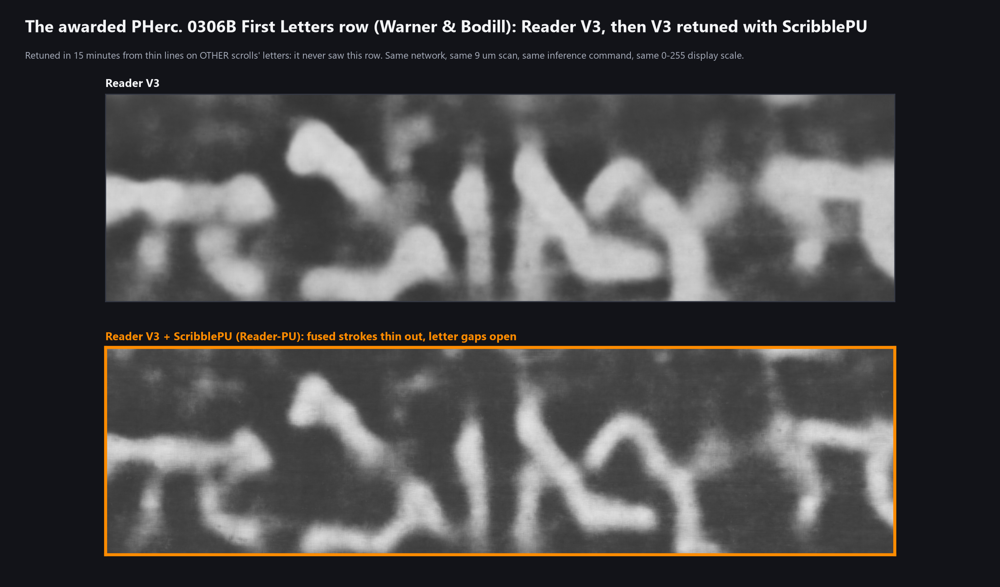
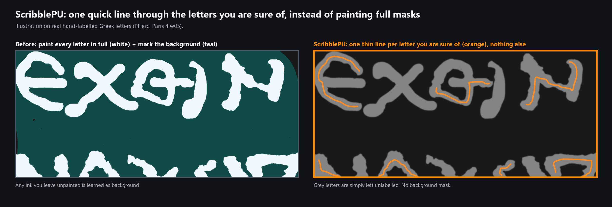
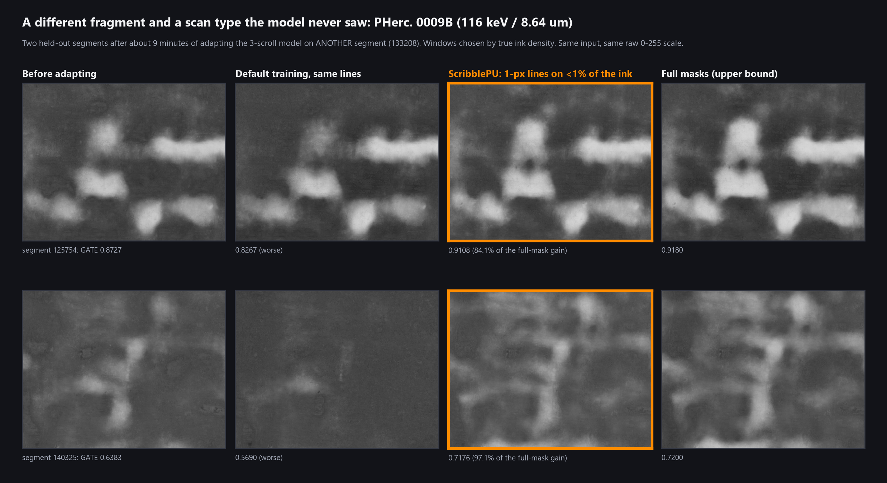
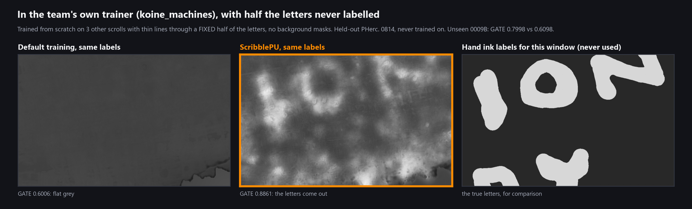
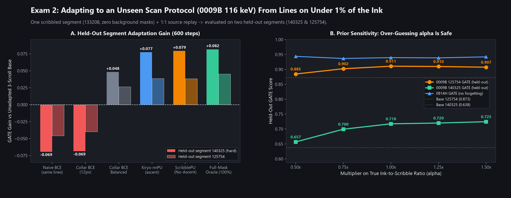
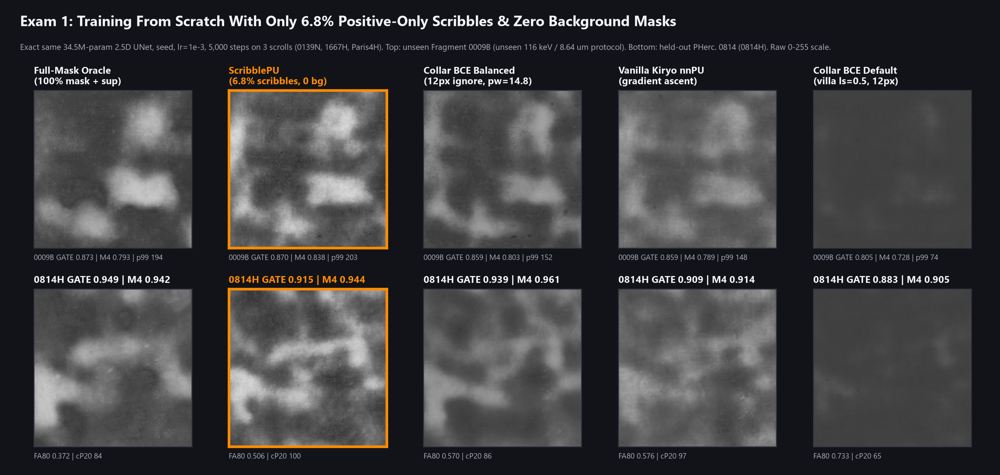
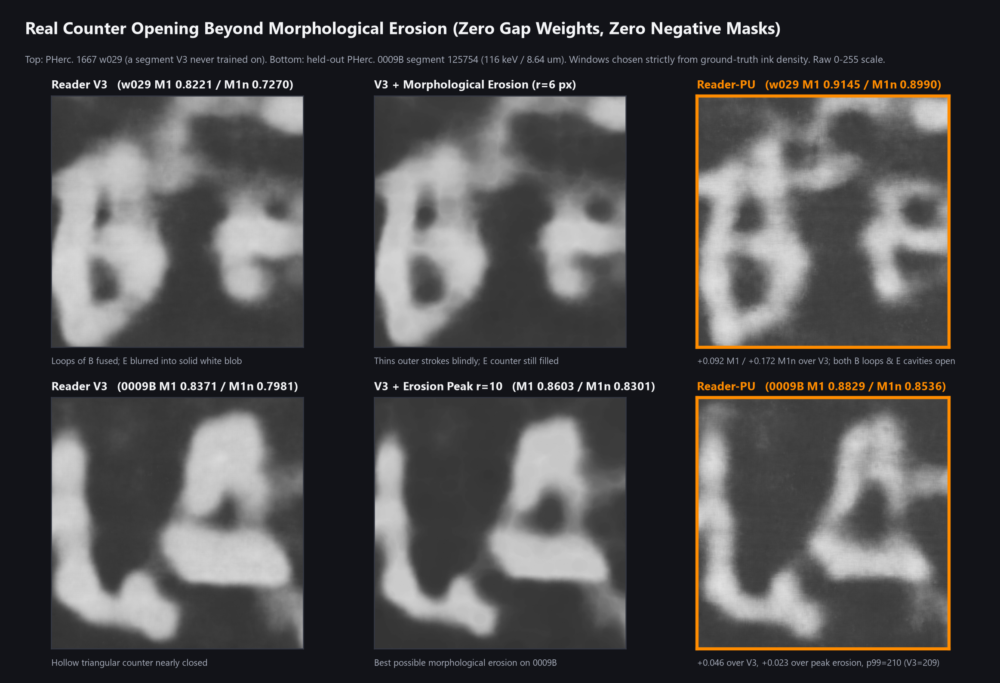
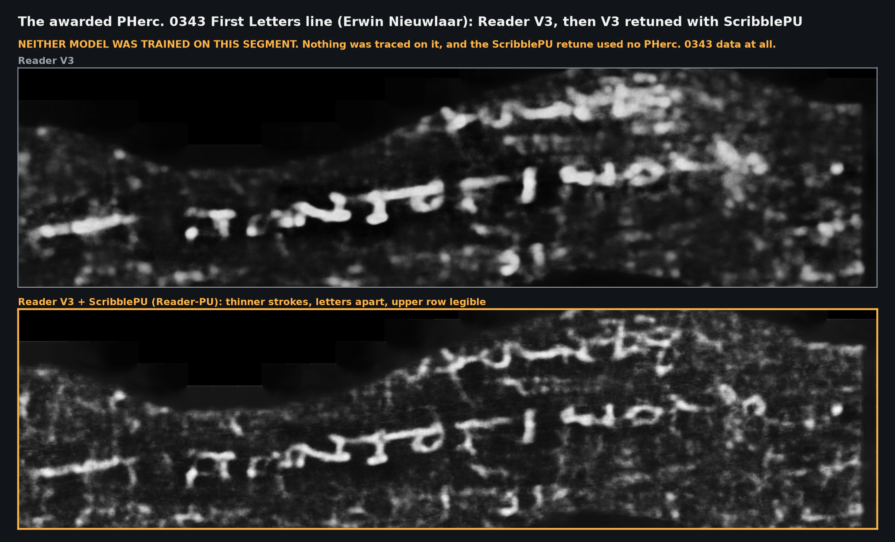

# ScribblePU: positive-unlabelled ink training. Models finally learn from half-labelled letters

**Until now, everything left unpainted was taught as "not ink", so every letter had to be painted in full, and on First Letters you only see pieces of them. ScribblePU changes that: draw a 1-pixel line wherever you're sure there's ink, leave the rest unlabelled, wait a few minutes, and you have your own fine-tuned ink model. No full letter masks, no background masks.**

It turns step 4 of the pseudo-labelling loop on the team's [Open Problems page](https://scrollprize.org/2026_open_problems#pseudo-labeling-bootstrapping-weak-signals), *"Create conservative pseudo-labels"*, into minutes of tracing: label only the ink you are sure of, and the rest is never taught as background.

A drop-in training loss for the team's ink trainer (`koine_machines` in [ScrollPrize/villa](https://github.com/ScrollPrize/villa)), plus Reader-PU, Reader V3 checkpoints retuned with it.
Checkpoints: [huggingface.co/domenicor046/scribble-pu](https://huggingface.co/domenicor046/scribble-pu)



*The awarded `PHerc. 0306B` First Letters row (credit: Warner & Bodill). Top: Reader V3. Bottom: the same Reader V3 network retuned with ScribblePU in 15 minutes, using only thin centre lines on other scrolls' letters as ink labels (`reader-pu-bhand.pth`). It never saw this row. Same scan, same inference command, same 0-255 scale: fused strokes thin out and the gaps between letters open. Reader-PU is a companion view for crowded rows, not a V3 replacement (trade-offs in section 4).*

---

## What ScribblePU is, and why this was not possible before

ScribblePU trains an ink model from **positive-only scribbles**: 1-pixel lines on some of the strokes you can see. Everything else stays unlabelled, and ink tiles need no background mask.

With default villa settings, every pixel you did not paint counts as background. Leave half the letters unpainted and the model learns that ink is background: it collapses to flat grey (peak brightness `p99 = 73-74` instead of `203`). So fitting a reader to a new scroll or a new scan protocol meant painting every letter in full first. On a First Letters scroll that is a trap: you only see pieces of letters, every stroke you skip is taught as background, and completing letters by guesswork risks teaching the model strokes that are not there. With ScribblePU you trace only what you are sure of and leave the rest unlabelled, including the faint bits you cannot decide on. This is the positive-unlabelled training the team has asked for, working on real 9 µm ink.

Standard positive-unlabelled learning (Kiryo et al., 2017) is the textbook starting point, but whenever its risk estimate dips below zero it takes a gradient-ascent step that pushes confirmed ink back toward background, and from scratch its ink comes out dimmer (`p99 = 147-148`). ScribblePU replaces that step with a clamp: traced ink keeps full brightness (`p99 = 187-203`), and in the 5,000-step run ScribblePU beats the textbook version on every metric shown (section 3). Verified blank-papyrus anchors help but are optional.

## What you can do with it

1. **Adapt a model to a new scan in about 9 minutes.** On fragment `PHerc. 0009B` (116 keV / 8.64 µm, a protocol the base model never saw), 1-pixel lines covering **under 1% of the ink pixels** of **one** segment recover **97.1%** of the gain that full masks give on a held-out segment (`+0.0793` vs `+0.0817` GATE). Default BCE makes the model worse (`-0.0693`), and class-balanced BCE gets `+0.0482`. Over-guessing how much ink is left unlabelled is safe, up to 1.5x.
2. **Use it in the team's own trainer, and skip half the letters.** In the stock `koine_machines` trainer, a model trained from scratch on thin lines through a **fixed** half of the letters (the other half never labelled) reads held-out `0009B` and `PHerc. 0814` (GATE `0.7998` / `0.8861`), while default training on the same labels collapses to flat grey (`0.6098` / `0.6006`). In 600-step adaptation, a fixed half of 1-pixel lines gives **107%** and **100%** of the full-mask gain on the two held-out segments.
3. **Train a model from scratch with thin lines.** From random weights, thin centre lines on 6.8% of the ink pixels (no stroke borders, zero background masks) reach **92.5% to 99.7%** of a full-mask model on unseen-protocol `0009B` across two training schedules (`0.8701` vs `0.8727` GATE in the 5,000-step run), with better fine-stroke recall (`+0.0442` M4) and letter separation (`+0.0930` M1) than the full-mask model in that run.
4. **Retune Reader V3 in minutes.** Fine-tuning V3 with ScribblePU on thin centre lines (Reader-PU) lifts letter separation on held-out `0009B` from **0.8371 to 0.8829 (+0.0458)**, `+0.0226` beyond V3's best morphological erosion, and on `PHerc. 1667 w029` from **0.8221 to 0.9145 (+0.0924)**, with zero dark craters on the `0306B` row.



*Illustration on real hand-labelled Greek letters (`PHerc. Paris 4 w05`): full ink and background masks vs one thin line through every other letter, the rest left unlabelled.*



*A different fragment and a scan type the base model never saw: held-out `PHerc. 0009B` segments `125754` and `140325` after about 9 minutes (600 steps) of adaptation on another segment (windows chosen by true ink density), raw 0-255 scale.*

<details>
<summary>Plain-English guide to the metrics</summary>

- **GATE / rAUC:** overall ink-vs-background detection across the segment (higher is better).
- **M1 / M1n:** letter separation: how cleanly tight gaps and loops open between strokes (higher is better).
- **M4:** fine-stroke recall on thin ink (higher is better).
- **FA80 / cP20:** blank-papyrus cleanliness: false-alarm rate on blank papyrus (`FA80`, lower is better) and quiet-background contrast margin (`cP20`, higher is better).
- **p99 / crater `p0.1`:** peak ink brightness (top 1%) on V3's 0-255 scale (`p99`, ~209 is V3 normal; ~73 means flat-grey collapse) and the darkest-hole floor on `0306B` (`p0.1` with `0 px < 30` means zero craters).

</details>

---

## 1. Use it now

### Option A: add ScribblePU to villa's ink trainer

`koine_machines` lives on the `merge-ink-pipelines` branch of villa. One patch adds the loss, its registration and its tests (checked on 2026-11-23 against the live branch head `47a9c37`: applies cleanly, all loss tests pass):

```bash
# in a villa checkout on the merge-ink-pipelines branch
git apply /path/to/scribble-pu/villa_pr/villa_full.patch
pytest ink-detection/koine_machines/training/loss/tests -q
```

Then label and train as usual, with two changes:

- **Labels:** draw 1-pixel lines along the strokes you can see into the segment's ink label image, mark the area you looked at in the supervision mask as usual, and leave every other stroke alone.
- **Loss:** put this in `train_config.json` (also in `villa_pr/example_config_brier_nnpu.json`):

```json
"loss": {
  "terms": [
    {
      "name": "BrierNNPULoss",
      "metric_name": "brier_nnpu",
      "weight": 1.0,
      "alpha": 14.5,
      "rho": 0.96,
      "y_lo": 0.25,
      "y_hi": 0.82,
      "w_blank": 0.1667,
      "batch_neg_risk": true
    }
  ]
}
```

`alpha` is your rough guess of true ink pixels per labelled pixel. Rule of thumb: `alpha = stroke_width_px / (line_width_px x fraction_of_strokes_traced)`. Example: 1-pixel lines through half the letters, strokes about 20 px wide: `alpha = 20 / (1 x 0.5) = 40`. (The `14.5` above is Exam 1's value, for 3-pixel lines.) Guessing a little high (1.0x to 1.5x) is safe; guessing low costs more (section 2).

### Tested in the stock villa trainer, with half the letters never labelled



Stock `koine_machines` (`merge-ink-pipelines` @ `47a9c37` + this patch, stock dataset and trainer, no blank anchors), from scratch on the `0139` / `1667` / `Paris 4` hand segments, 3,000 steps, with ink labels cut down to thin lines on a **fixed** half of the letters (6.9% of the ink pixels; the other half never labelled):

| Held-out read | ScribblePU | Default training, same labels |
|---|---:|---:|
| `0009B 125754` GATE / peak brightness p99 | **0.7998 / 207** | 0.6098 / 69 (flat grey) |
| `PHerc. 0814` GATE | **0.8861** | 0.6006 |
| False ink on blank papyrus (FA80) | **0.6248** | 0.8554 |

### Option B: run a Reader-PU checkpoint with your usual command

If you already run Reader V3 or the team's `ink_9um` models, only the checkpoint changes:

```bash
hf download domenicor046/scribble-pu reader-pu-deconly-soup50.pth --local-dir .
python -m koine_machines.inference.infer <surface_volume.zarr> reader-pu-deconly-soup50.pth out.tif --overlap 0.5 --blend-mode hann --direction both
```

`reader-pu-deconly-soup50.pth` is the balanced companion; `reader-pu-bhand.pth` gives the most letter separation on crowded, high-signal rows like `0306B` (section 4). The output is on Reader V3's 0-255 scale (~63 blank papyrus, ~209 bright ink): do not hard-threshold at 128; look at the raw map and adjust the contrast window so faint ink stays visible.

### Option C: standalone Python package

```bash
pip install -e .
```

```python
from scribble_pu import BrierNNPULoss, certain_blank_brier_loss, build_certain_blank_mask

criterion = BrierNNPULoss(y_lo=0.25, y_hi=0.82, rho=0.96, mode="no_ascent_batch")
loss, stats = criterion(logits, pos_scribble_mask, unlabeled_mask, alpha=14.5)
```

---

## 2. Adapting to a new scan protocol in about 9 minutes (Exam 2)



This is the everyday First Letters case: a model that reads well on its own scans meets a new scan protocol. I took the 3-scroll full-mask model from Exam 1 (which never saw 116 keV / 8.64 µm CT) and adapted it for 600 steps (about 9 minutes on one 16 GB GPU, start-up included) using only 1-pixel lines along the stroke centres of **one** `PHerc. 0009B` segment (`20250919133208`): **0.73% of its ink pixels**, a random half of them used at each step, zero background masks, plus 1:1 replay of the source scrolls and verified `0172` certain-blank papyrus. Then I tested on **two held-out `0009B` segments** (`140325` and `125754`) and on held-out `PHerc. 0814` (`0814H`) to check that nothing was forgotten.

| Adaptation arm (600 steps on `133208`) | Held-out `140325 GATE` (delta) | Held-out `125754 GATE` (delta) | Held-out `125754 M1` | Held-out `140325 rAUC` | Held-out `0814H M4` |
|---|---:|---:|---:|---:|---:|
| Unadapted 3-scroll base | 0.6383 | 0.8727 | 0.7016 | 0.6122 | 0.9419 |
| Full-mask adaptation (100% mask) | 0.7200 (+0.0817) | 0.9180 (+0.0453) | 0.7434 | 0.6946 | 0.9509 |
| **ScribblePU (No-Ascent Batch, lines on <1% of ink)** | **0.7176 (+0.0793)** | **0.9108 (+0.0381)** | **0.7561** | **0.6923** | **0.9472** |
| Vanilla Kiryo nnPU (same lines) | 0.7157 (+0.0774) | 0.9114 (+0.0387) | 0.7562 | 0.6917 | 0.9442 |
| Collar BCE balanced (`pos_weight=alpha`) | 0.6865 (+0.0482) | 0.8989 (+0.0262) | 0.7290 | 0.6644 | 0.9377 |
| Collar BCE default (12 px ignore) | 0.5697 (-0.0686) | 0.8327 (-0.0400) | 0.6522 | 0.5486 | 0.9331 |
| Naive BCE default (same lines) | 0.5690 (-0.0693) | 0.8267 (-0.0460) | 0.6446 | 0.5487 | 0.9328 |

- **97.1% of the full-mask gain from under 1% of the ink pixels:** ScribblePU recovers `+0.0793` of the full-mask model's `+0.0817` on `140325`, and on `125754` it beats the full-mask model on letter separation (M1 `0.7561` vs `0.7434`).
- **Default training cannot do this:** default naive and collar BCE make the model worse (`-0.0693 / -0.0686` GATE on `140325`). Exact class reweighting (`Collar BCE balanced`) recovers `+0.0482`.
- **You do not need an exact `alpha`:** sweeping `alpha` over `0.50x`, `0.75x`, `1.00x`, `1.25x` and `1.50x` of the true ink-to-scribble ratio gives `140325 GATE` = **0.6569, 0.6995, 0.7176, 0.7202, 0.7247** and `125754 GATE` = **0.8846, 0.9023, 0.9108, 0.9098, 0.9074** (`0814H M4` stays at **0.9407-0.9551**). Over-guessing is safe: at 1.25x and 1.5x the gain on `140325` matches or beats the full-mask gain. Under-guessing costs more: 0.75x keeps 75% of it, 0.50x only 23%.
- **A fixed half is enough:** with 1-pixel lines on a **fixed** half of the letters of a 2048 x 2048 area of `133208` (the other half never labelled, 3.3% of its ink pixels), 600 steps give `+0.0617` on `140325` vs `+0.0578` for full masks on the same area (**107%**), and `+0.0333` vs `+0.0333` on `125754` (`results/check_fixed_half.json`).
- **Where the clamp matters:** with 1:1 replay of supervised source scrolls, vanilla Kiryo nnPU is stabilised and scores about the same as ScribblePU here (`+0.0774` vs `+0.0793`; `0.9114` vs `0.9108`). The clamp matters when PU training runs without that replay: from scratch (section 3) and when retuning V3 (section 4).

---

## 3. Training from scratch with 6.8% positive-only scribbles (Exam 1)



All 7 models below use the **same 34.5M-parameter 2.5D UNet**, the same seed (`42`), optimizer (`AdamW`, `lr=1e-3`, 5,000 steps) and 3 training scrolls (`0139N`, `1667H`, `Paris4H`), plus verified `0172` certain-blank anchors. Fragment `0009B` (an unseen 116 keV / 8.64 µm protocol) and `PHerc. 0814` (`0814H`) are held out.

In the scribble regime (`half_centerline`), only thin centre lines (a 3-px spine along each stroke) on a random 50% of the area are given at each step (~6.8% of true ink pixels; the half is redrawn every step). Stroke borders are never labelled, and ink tiles have zero background masks.

| Arm (all 5,000 steps from scratch) | Labels used | Unseen `0009B GATE` | Unseen `0009B M4` | Unseen `0009B rAUC` | Unseen `0009B M1 / M1n` | `0009B p99` | Held-out `0814H GATE / M4` | `FA80` | `cP20` |
|---|---|---:|---:|---:|---:|---:|---:|---:|---:|
| Full-mask model (`villa` BCE + Dice) | 100% mask + sup | 0.8727 | 0.7933 | 0.8706 | 0.7015 / 0.6677 | 194 | 0.9493 / 0.9419 | 0.3721 | 84 |
| **ScribblePU (No-Ascent Batch)** | **6.8% scribbles, 0 bg** | **0.8701** | **0.8375** | **0.8838** | **0.7945 / 0.8059** | **203** | 0.9150 / **0.9439** | **0.5061** | **100** |
| Collar BCE balanced (`pos_weight=14.8`) | 6.8% scribbles + 12 px ignore | 0.8590 | 0.8028 | 0.8714 | 0.8332 / 0.8281 | 152 | **0.9394 / 0.9611** | 0.5704 | 86 |
| Vanilla Kiryo nnPU (gradient ascent) | 6.8% scribbles, 0 bg | 0.8586 | 0.7895 | 0.8677 | 0.7570 / 0.7443 | 148 | 0.9093 / 0.9145 | 0.5757 | 97 |
| Collar BCE default (`villa` `ls=0.5`) | 6.8% scribbles + 12 px ignore | 0.8046 | 0.7283 | 0.8137 | 0.6910 / 0.6460 | 74 | 0.8829 / 0.9048 | 0.7328 | 65 |
| Naive BCE default (`villa` `ls=0.5`) | 6.8% scribbles, 0 bg | 0.8256 | 0.7419 | 0.8356 | 0.6858 / 0.6107 | 73 | 0.9055 / 0.9104 | 0.9084 | 64 |
| ScribblePU (`partial_letter20` blocks) | 20% painted blocks, 0 bg | 0.7554 | 0.6417 | 0.7459 | 0.6515 / 0.6352 | 146 | 0.8796 / 0.9088 | 0.5568 | 91 |

*Exam 1 compares labelling regimes at ~10% of Reader V3's training budget (5,000 steps on 3 scrolls). These are benchmark models, not finished readers: every arm, the full-mask model included (`FA80 = 0.3721`), puts down more false ink on blank papyrus than full-budget Reader V3 (`0.0554`).*

- **Matches the full-mask model on an unseen scan protocol:** with ~6.8% scribbles and zero background masks, ScribblePU reaches **99.7%** of the full-mask model's `0009B GATE` (`0.8701` vs `0.8727`) and beats it on `M4` (+0.0442), `rAUC` (+0.0132) and `M1` (+0.0930).
- **Default `villa` BCE settings collapse; class-balanced BCE is a strong simple baseline:** without class weighting, default naive and collar BCE collapse to flat grey (`p99 = 73-74`) and lose `-0.047` to `-0.068` GATE on `0009B`. With exact class weighting (`pos_weight = 14.8`), collar BCE is competitive: it edges out ScribblePU on in-protocol `0814H` (`GATE 0.9394 / M4 0.9611`) and on `0009B M1/M1n` (`0.8332 / 0.8281`), while ScribblePU beats it on unseen-protocol `0009B GATE` (`0.8701` vs `0.8590`), `M4` (+0.0347), `rAUC`, `FA80` (-0.0643), `cP20` (+14), full ink brightness (`p99 = 203` vs `152`), and clearly in adaptation (section 2: `+0.0793` vs `+0.0482`).
- **ScribblePU vs vanilla Kiryo, both schedules:** in this 5,000-step run (`lr=1e-3`) ScribblePU beats Kiryo on every metric shown (`0009B GATE` +0.0115, `M4` +0.0480, `rAUC` +0.0161, `M1` +0.0375, `0814H GATE` +0.0057, `FA80` -0.0696, and `+55` grey levels brighter ink, `p99 = 203` vs `148`). In an earlier, shorter 3,000-step run with the same loss (`lr=3e-4`, `results/exam1_from_scratch_s3k_pilot.json`, full-mask blank `FA80` `0.5887`), `0009B GATE` was `0.8970` full-mask, `0.8564` Kiryo (`p99 = 147`) and `0.8295` ScribblePU (`92.5%` of full-mask, `p99 = 187`; `0814H GATE 0.9391` vs Kiryo's `0.9316`). So the Kiryo ranking on `0009B` depends on the schedule, while ScribblePU keeps full ink brightness in both (`p99 = 187-203` vs Kiryo's `147-148`) and both PU losses stay far above default BCE.
- **For annotators:** quick thin centre lines (6.8% of ink pixels) beat painting 20% of full-width letter patches by `+0.1147` GATE on `0009B`, with 3x fewer labelled pixels.

---

## 4. Reader-PU: Reader V3 retuned from thin centre lines



Reader-PU applies ScribblePU directly to Reader V3, using only thin centre lines (a 3-px spine) as confirmed ink (`P`) and everything off the centreline as unlabelled (`U`), with zero gap weights and zero negative masks on ink tiles. Erosion thins every stroke by the same amount; Reader-PU separates letters further than V3's best erosion on `0009B` (`+0.0226` M1) and opens the `B` and `E` counters on `w029` that erosion leaves filled (also the triangular counter on `0009B` and the arches on the `0306B` row), while keeping peak ink brightness on V3's scale (`b9_p99 = 210` vs V3's `209`, ink head bias shift `+0.0029`, zero craters).



*A second awarded line, `PHerc. 0343` (credit: Erwin Nieuwlaar). Top: Reader V3. Bottom: `reader-pu-bhand.pth`. Neither model was trained on this segment, and the ScribblePU retune used no `PHerc. 0343` data at all (Reader V3's training includes a separate opened fragment, `PHerc. 0343P`). Same surface, same inference command, same 0-255 scale: thinner strokes, letters apart, and the upper row becomes easy to follow.*

**Scope:** Reader-PU is a **companion view next to V3** for crowded or fused rows, not a V3 replacement on faint scrolls: it buys letter separation with more false ink on blank papyrus (`FA80`) and lower recall on faint `0841`. The frozen-encoder 50/50 blend removes most of that cost.

| Model (same V3 architecture) | `0009B M1` (fixed / best) | `0009B M1n` | `0009B GATE / M4` | `w029 M1 / M1n` | `w029 GATE / M4` | `0306B` crater `p0.1` (`<30 px`) | `0841 ag1` `GATE / M2` | `FA80` |
|---|---:|---:|---:|---:|---:|---:|---:|---:|
| **Reader-PU (`reader-pu-bhand.pth`)** | **0.8829 / 0.8748** | **0.8536** | 0.9675 / 0.9535 | **0.9145 / 0.8990** | 0.9423 / 0.9542 | **61 (0)** | 0.8306 / 0.8242 | 0.1152 |
| **Reader-PU Soup50 (`reader-pu-soup50.pth`)** | 0.8732 / 0.8657 | 0.8455 | **0.9748 / 0.9577** | 0.9040 / 0.8750 | **0.9523 / 0.9563** | 55 (0) | 0.8651 / 0.8289 | 0.0766 |
| **Reader-PU DecOnly Soup50 (`reader-pu-deconly-soup50.pth`)** | 0.8691 / 0.8643 | 0.8387 | 0.9742 / 0.9533 | 0.8902 / 0.8491 | **0.9528 / 0.9568** | 54 (0) | **0.8774 / 0.8287** | **0.0754** |
| Reader V3 (baseline) | 0.8371 / 0.8301 | 0.7981 | 0.9787 / 0.9563 | 0.8221 / 0.7270 | 0.9512 / 0.9446 | 54 (0) | 0.8935 / 0.8075 | 0.0554 |
| V3 + morphological erosion (`r=10` peak) | 0.8603 / 0.8546 | 0.8301 | 0.9741 / 0.9543 | n/a | n/a | n/a | n/a | n/a |

*`0009B` = held-out segment `125754`; `w029` = a `PHerc. 1667` segment V3 never trained on (other `1667` segments were in V3's training set); `0841 ag1` = a window on `PHerc. 0841`, a scroll V3 never saw.*

**Which checkpoint to pick:** **`reader-pu-deconly-soup50.pth`** is the balanced companion (V3's 30.2M encoder frozen, only the 4.3M decoder tuned, in 6.9 minutes, blended 50/50 with V3): `FA80 = 0.0754`, `0841 GATE = 0.8774`, and it beats V3 on `w029 GATE`, `w029 M4` and `0841 M2`. **`reader-pu-bhand.pth`** (the hero image; 15 minutes of tuning) gives the most separation on crowded, high-signal rows like `0306B`.

---

## 5. Checks against invented strokes: window size, edge scribbles, cut gaps

After the release, the team suggested three checks that any large-window ink model should pass. All three reuse the stock-trainer setup from section 1 (3,000 steps from scratch, thin lines through a fixed half of the letters), with pass/fail bars written down before the runs (`experiments/check_window_edge_cutgap/PREREG.md`).

| Check | What changes | Result |
|---|---|---|
| **Small window** | 128 px tiles (Reader v2's window, smaller than one letter) instead of 384 px | ScribblePU still beats default training by `+0.1060` GATE on `0009B` (`0.6453` vs `0.5393`) and `+0.1581` on `PHerc. 0814` (`0.7002` vs `0.5421`), and default training still collapses to flat grey (`p99 = 69`). Its ink is dimmer than at 384 px (`p99 = 131` vs `207`; it sees 9x less papyrus per step in this short run), so by its pre-set brightness bar this check is inconclusive. |
| **Edge scribbles** | In half of the labelled blocks the line runs along the stroke edges instead of the centre | Detection holds or improves: GATE `0.8012` vs `0.7998` on `0009B`, `0.9249` vs `0.8861` on `0814`. Letters come out less separated (M1 `0.5656` vs `0.6577`), so centre lines are the better default for reading. |
| **Cut gaps** | Letter-size gaps (46 to 116 px, about 0.4 to 1.0 mm) cut into real strokes on held-out `PHerc. 0841` and `0009B` regions, filled with blank papyrus from the same sheet | Reader-PU keeps **58 to 61%** of the gaps open (both checkpoints), more than Reader V3's **55%**: retuning with ScribblePU adds no stroke completion and even keeps gaps slightly more open. Reader v2 (128 px window) keeps 79%, so the test does pick up a large window's extra bridging. |

A gap counts as open when the model's read at its centre falls to 30% or less of the original stroke's, measured above blank papyrus (58 cuts on 4 regions). Two controls check the test itself: blank pasted onto blank papyrus changes nothing (median fill 0.02 to 0.03), and ink pasted into the cuts is read as ink (median 0.70 to 0.95). The scripts read our local copies of the volumes; point `cutgap.py` at your own surface volumes and labels to run the same test on any checkpoint.

---

## 6. Notes on the tests

- **Labels:** the lines in the tests were drawn by a script along the centre of existing ink labels (section 5 also tests lines along the stroke edges), so every comparison with full masks is exact. Exam 2's lines are about 1.4 px wide; Exam 1 and Reader-PU use a 3-px spine.
- **Fixed or moving half:** Exams 1 and 2 show a fresh random half of the lines at each step. The two checks in sections 1 and 2 use one **fixed** half (the other half never labelled) and give the same picture: 107% of the full-mask gain in adaptation, and a clean model in the stock villa trainer.
- **Runs:** one training run per arm (seed 42). The differences behind the claims are large: `+0.19` GATE over default training in the stock trainer, 97% to 107% of the full-mask gain in adaptation.
- **Schedules:** both from-scratch schedules land at 92.5% to 99.7% of full masks. Which PU variant leads on `0009B` depends on the schedule (Kiryo `0.8564` vs `0.8295` at 3k, ScribblePU `0.8701` vs `0.8586` at 5k), and ScribblePU keeps full ink brightness in both (`p99 = 187-203` vs Kiryo's `147-148`). Exam 1 models are quick benchmark runs (~10% of V3's training budget) built to compare labelling regimes.
- **Fragment:** `0009B` is an opened fragment scanned at 116 keV / 8.64 µm; Exam 2 tests on two other segments of it (`140325`, `125754`).
- **Blank papyrus:** the exams also used an optional label channel for verified blank papyrus; the stock-trainer check shows it is not required.

---

## 7. How it works

Standard Kiryo et al. (2017) nnPU estimates the negative risk of the unlabelled pixels:

`R_neg = R_u_neg - pi_u * R_p_neg`

Whenever `R_neg < 0`, Kiryo takes a **gradient-ascent step** (`loss = -frac_U * R_neg`), which drops the positive term `pi_tot * R_p_pos` and pushes confirmed positive pixels `P` down toward `y_lo`.

With human-style scribbles on 2D ink, `R_neg < 0` happens on **16% to 60% of tiles**, for two reasons:
1. **Centrelines are brighter than stroke borders:** 1-pixel centrelines sit on the brightest ink cores, so `R_p_neg` over-estimates the negative loss of dimmer off-centre ink in `U`.
2. **Clustered labels:** scribbling some strokes and not others makes the fraction of labelled ink swing from tile to tile.

ScribblePU replaces the ascent branch with a non-negative clamp and computes `R_neg` over the whole microbatch (`villa_pr/brier_nnpu.py`, ~140 lines with comments):

```python
R_neg = l_neg[U].mean() - pi_u * l_neg[P].mean()
loss = pi_tot * l_pos[P].mean() + frac_U * torch.clamp(R_neg, min=0.0)
```

- When `R_neg >= 0`: identical to unbiased Brier-nnPU (`tests/test_losses.py` checks agreement with the supervised Brier risk to `< 0.0003`).
- When `R_neg < 0`: the negative term is clamped at `0` while `pi_tot * R_p_pos` stays active, so confirmed scribbles are **never** pushed toward background (`villa_pr/test_brier_nnpu.py` checks this on the gradients).
- **Verified certain-blank anchors (`scribble_pu/certain_blank.py`):** the `PHerc. 0172` segments in Reader V3's training data (`w062`, `w078`, `w079`, `w080`) contain **21-30% labelled ink**, so treating whole tiles there as blank papyrus trains real ink toward background. `build_certain_blank_mask` keeps only `supervised & (~ink) & (EDT(~ink) >= 16 px)`.

---

## 8. Check every number yourself

```bash
# 1. Loss unit tests (CPU, ~2 seconds)
python tests/test_losses.py

# 2. Every number in this README and the PR text against results/*.json, the checkpoint hashes, the figures
python scripts/verify_release_numbers.py
#    optional extras: VILLA_DIR=<villa checkout on merge-ink-pipelines> adds the patch + CompositeLoss checks,
#    SCRIBBLEPU_CKPT_DIR=<folder with the downloaded checkpoints> checks the files' SHA256

# 3. Regenerate figures 0-6 (needs the local model reads and scroll labels; the finished PNGs are already in figures/);
#    figure 7: experiments/reader_pu_0343_line/ (read_0343_line.py, then make_fig7.py)
python scripts/make_release_figures.py
```

<details>
<summary>Checkpoint SHA256 hashes and repository layout</summary>

- `reader-pu-bhand.pth` (`260.27 MB`, SHA256 `9abc43e04af97b1f575efd49cdf66230755f10f3b99618a3ef598a958cb743cc`)
- `reader-pu-soup50.pth` (`260.27 MB`, SHA256 `7a0a540ed885655722f19c5f5d0101eeff5877476c347ee7d7b8feb95ef96b3d`)
- `reader-pu-deconly-soup50.pth` (`260.27 MB`, SHA256 `5a966b29ec5ff8eabc23315ac2bffa56525c575537f1b4dc807801ded569130b`)

```
scribble-pu/
  scribble_pu/
    losses.py                  # BrierNNPULoss (no_ascent, no_ascent_batch, kiryo) + certain_blank_brier_loss
    certain_blank.py           # Verified EDT >= 16 px certain-blank mask builder
  villa_pr/
    villa_full.patch           # One-step patch for villa merge-ink-pipelines: loss + registration + tests
    brier_nnpu.py              # The koine_machines CompositeLoss term (also inside villa_full.patch)
    test_brier_nnpu.py         # Its villa-side tests (also inside villa_full.patch)
    losses_patch.diff          # The 17-line LOSS_TERM_BUILDERS registration alone
    example_config_brier_nnpu.json
    VILLA_PR_DESCRIPTION.md
  tests/test_losses.py         # 5 CPU unit tests
  experiments/                 # the exact scripts behind every number (they read local copies of the data and research helpers)
    common/                    # shared helpers (kt_nnpu.py)
    exam1_from_scratch/        # 7-arm matched from-scratch benchmark (train + eval)
    exam2_adaptation/          # Unseen-protocol 0009B adaptation + 5-point alpha sweep
    exam3_reader_pu/           # Reader-PU (B-Hand + DecOnly) training + dev evaluation
    check_koine_trainer/       # Stock koine_machines run, fixed half of the lines (labels, configs, scoring)
    check_fixed_half/          # Fixed-half adaptation vs full masks (Exam 2 code)
    check_window_edge_cutgap/  # Small window, edge scribbles, cut gaps (frozen PREREG, configs, scripts)
    reader_pu_0343_line/       # Reader V3 vs Reader-PU on the awarded PHerc. 0343 line (read + figure 7)
  figures/                     # 8 figures
  results/                     # Raw evaluation JSONs (incl. the 3k run) + checkpoint SHA256s
  scripts/
    make_release_figures.py
    verify_release_numbers.py
```

</details>

**Found something on your scroll?** Trace what you are sure of, train for a few minutes, and read it again. I would love to see what you find.

MIT License. Author: Domenico Russo. Built on the Vesuvius Challenge `ScrollPrize/villa` (`koine_machines`) stack and public scroll data.
`PHerc. 0306B` First Letters Prize row credit: Warner & Bodill.
